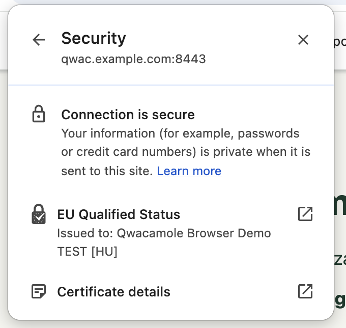
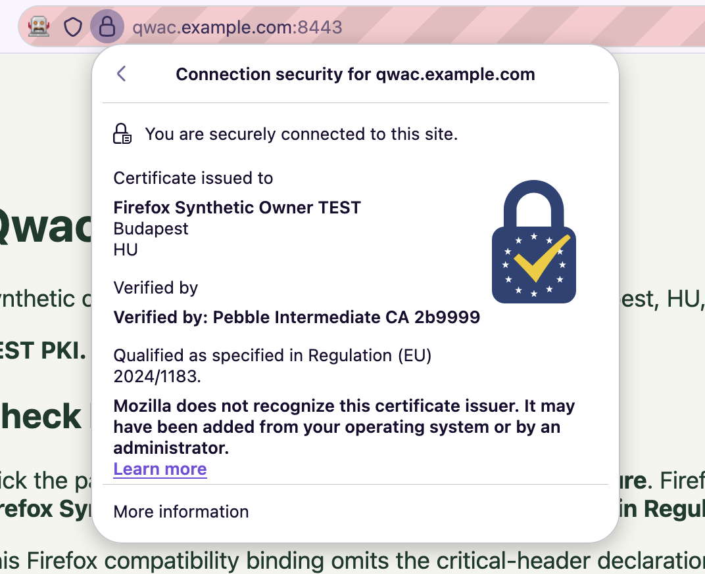

# Qwacamole

A Go / Caddy-native local 2-QWAC experiment. It uses separate test QWAC and
ordinary TLS authorities, a real Pebble ACME server, Annex B JAdES bindings, and
an unmodified browser's native verifier. The visible demo supports stock Chrome
and Firefox; each has a separate isolated trust setup.

The ordinary TLS certificate secures HTTPS. A separate QWAC certificate carries
the synthetic owner's details; its key signs a binding to the TLS certificate.
Chrome verifies that binding and its QWAC chain independently of the ordinary
TLS chain. Renewing TLS therefore requires publishing a new binding, while the
owner's QWAC certificate can stay the same.

The demonstration is accepted with one documented Chromium implementation gap:
stock Chrome **154.0.8037.95 and 154.0.8037.98** accept an expired binding `exp`
header. Chrome's native parser explicitly ignores that field. The browser suite
retains the failing assertion so this limitation stays visible. Native verification before and after
automatic renewal, real TLS validation, existing connections, trust separation,
restart, refresh, and signing/publication failure recovery have been observed.
The three-module extraction and new native browser runs are recorded in [the dated refactor report](docs/evidence-monorepo-20261005.md).
The repository owner accepted the expiry gap on 4 October 2026; see
[the evidence report](docs/evidence.md) for results and attempted browser alternatives.

This is synthetic **TEST PKI**, without legal qualification, EU Trusted List
registration, production CA enrollment, or operational QTSP practices.

Start with [Prerequisites](#prerequisites) and [Quickstart](#quickstart). For the
individual Chrome checks, use [Manual validation](#manual-validation-step-by-step).
For Firefox, start with [Firefox quickstart](#firefox-quickstart).
[Troubleshooting and evidence](#troubleshooting-and-evidence),
[Architecture](#architecture-and-lifecycle), and
[Browser trust and CT](#isolated-browser-trust-and-ct) explain the setup in detail.

## Installable Caddy plugin

The current hardening branch prepares an **unpublished public alpha**. It adds
stable uncached discovery, transactional activation, document collection,
expiry-driven refresh and enforced capacity limits. See
[operations and migration](docs/operations.md) and the
[release checklist](docs/alpha-release.md). Native browser, hosted CI and
exact-ref remote installation/runtime acceptance are recorded in the [7 October hardening evidence](docs/evidence-hardening-20261007.md).
Chrome retains its documented ignored-exp failure; Firefox passes all eleven
fixtures. Historical reports below remain dated evidence for their original refs.

For supplied QWAC credentials and a normal single-host ACME-managed Caddy site,
use the [installation and operations guide](docs/caddy-plugin.md). It includes
authenticated private-GitHub installation, complete Caddyfile proxy/file/Pebble
examples, JSON migration, explicit local QWAC trust, reload/credential replacement
and portable checks. The development browser quickstarts below remain supported.
New integration verification is recorded separately in
[the plugin evidence report](docs/evidence-plugin-20261006.md), including the
remotely tested immutable ref, portable CI, and fresh native browser checks.
[The PR review follow-up](docs/evidence-review-20261007.md) records the subsequent
wildcard-policy fix and refreshed installation ref.

## Prerequisites

The tested platform is **macOS on Apple Silicon**, with stock Google Chrome
154.0.8037.95 / **PKIMetadata 1793** and 154.0.8037.98 / **PKIMetadata 1798**.
Other browser/component pairs are version-dependent; automatic detection does not
establish compatibility.
The bundled bootstrap supports macOS arm64 only. Other platforms have not been
validated and need a port of the bootstrap and browser discovery.

You need `git`, `curl`, `tar`, `shasum`, `make`, and network access to Go download
and module servers. The repository is currently private; use authorized Git
credentials and the private-module setup in the [plugin guide](docs/caddy-plugin.md#installation-from-the-private-github-repository).
Go does not need to be installed beforehand: `make build`
downloads a checksum-verified runtime, xcaddy, and Pebble into `.tools/`, then
builds `bin/qwacamole` and `bin/caddy`. The first build may take several minutes.
Docker, administrative privileges, hosts-file edits, and system-trust changes
are unnecessary. Run all commands below from the repository root.

Check your browser version and component directory:

```sh
"/Applications/Google Chrome.app/Contents/MacOS/Google Chrome" --version
ls "$HOME/Library/Application Support/Google/Chrome/PKIMetadata"
```

The selected version directory must contain genuine `manifest.json` and `crs.pb`
files. If no component exists, open the normal Chrome installation and inspect
`chrome://components` for PKI Metadata, then allow its normal component update to
finish. This project only reads that directory and patches a copy. It does not
install or alter the normal browser's component. Keep the browser and component
pair stable while comparing before/after renewal results.

Only one demo or full integration runner can run at a time. These loopback ports
must be free:

| Port | Purpose |
|---|---|
| TCP 8443 | Caddy HTTPS diagnostic site |
| TCP 5002 | ACME HTTP-01 challenge and public test PKI |
| TCP 14000 / 15000 | Pebble ACME / management APIs |
| TCP 2019 | Caddy admin API |
| UDP 8053 | Local ACME DNS responder |
| TCP 9443 / 9444 / 9445 | Negative-test TLS fixtures |

## Quickstart

Choose the synthetic owner data to put in the QWAC certificate, then run one
command to build, start the local services, prepare browser trust, and open the
example site in a **visible stock Chrome window**:

```sh
git clone https://github.com/cztamas/qwacamole.git
cd qwacamole
git checkout codex/public-alpha-hardening
make browser-demo DEMO_ARGS='-organization "Example Synthetic Owner TEST" -country HU -locality Budapest -registration NTRHU-TEST-0001'
```

The organization, country, locality, and registration are signed certificate
subject data. The RS256 Annex B binding links that QWAC certificate to the
ordinary TLS certificate for the fixed local hostname `qwac.example.com`.
Omit `DEMO_ARGS` to use the default synthetic owner. The command creates a fresh
`.local/browser-demo-*/` state and a fresh isolated profile on every invocation,
so there is no old Pebble root or browser trust to clean before relaunching.
Only one demo can use the fixed local ports at a time. A second launch checks
those ports before generating state and reports the occupied port immediately.

Wait for the site to open, then inspect **Chrome's own UI**, as in the reference
Security panel:

1. Click the site controls icon immediately to the left of the address.
2. Click **Connection is secure** to open the **Security** panel.
3. Confirm **EU Qualified Status** and
   **Issued to: Example Synthetic Owner TEST [HU]**.
4. Click the qualified-status row to inspect the QWAC certificate. The separate
   **Certificate details** row describes the ordinary TLS certificate.

Observed in stock Chrome 154 with the synthetic `Qwacamole Browser Demo TEST`
owner (change the command's organization to use that exact example):



The [QWAC certificate viewer](docs/images/qwac-certificate-viewer.png) shows the
same organization and separate test QWAC issuer. These are captures of Chrome's
native UI, not a simulated panel rendered in the web page.

The owner and country in the qualified-status row must match your input; changing
`-organization` or `-country` changes the signed values shown there. The page
shows all four synthetic owner fields and current binding state, but its text
does not assert browser verification. **EU Qualified Status is a native Chrome
security indicator**, not HTML rendered by this demo. With our synthetic trusted
authority it is a local test of that UI, not legal EU qualification.

Leave the terminal running while inspecting the browser. Automatic TLS renewal
and binding refresh continue in the background. Reload the site after renewal
and reopen its Security panel to check that qualified status remains visible.
Chrome may retain an existing HTTP/2 connection and display its original TLS
certificate even after that certificate's six-minute expiry. The binding keeps
that certificate covered alongside the renewed certificates for this demo state.
New connections still require a currently valid TLS certificate. To inspect the
replacement certificate itself, open a fresh browser check as described below.
The browser remains open beyond the startup check; no headless browser or static
page screenshot substitutes for this interactive flow.

Close the demo browser's windows or press **Ctrl-C** in the terminal to stop its
browser, Caddy, Pebble, and DNS responder. The command then reads the flushed
NetLog and asserts native verification, including the injected QWAC root. A
successful shutdown prints `PASS native Chrome QWAC verification`. The printed
state directory retains `evidence/interactive-netlog.json` and
`evidence/interactive-result.json`, plus certificates, bindings, and logs. Use
`make clean STATE=.local/browser-demo-<printed-suffix>` after preserving any
evidence you need. `STATE` on `make browser-demo` selects the **parent** directory
for its fresh run, whereas cleanup selects the exact generated child.

For an explicit compatible browser/component pair:

```sh
make browser-demo \
  DEMO_ARGS='-organization "Example Synthetic Owner TEST" -country HU -locality Budapest -registration NTRHU-TEST-0001' \
  BROWSER_ARGS='-browser "/Applications/Google Chrome.app/Contents/MacOS/Google Chrome" -metadata "/Users/you/Library/Application Support/Google/Chrome/PKIMetadata/1793"'
```

Use the same binary and component throughout a run. Native UI labels can vary by
browser version or language; the tested English Chrome 154 pair is described
above. The command enables `VerifyQWACs`, injects separate TLS/QWAC authorities
only into its copied profile, and applies the isolated CT-only exception described
in [Browser trust and CT](#isolated-browser-trust-and-ct). It does not alter your
normal browser or system trust or bypass ordinary certificate errors.

The diagnostic page is `https://qwac.example.com:8443/`. The launcher maps this
reserved example hostname to `127.0.0.1` in its isolated process. Opening that
URL in an ordinary browser does not reproduce the required routing or trust.

## Firefox quickstart

Tested with **stock Firefox 157.0** on macOS Apple Silicon. Firefox has desktop
native QWAC support enabled by default since version 153. Install Firefox and
NSS's `certutil` first (Homebrew supplies the latter):

```sh
brew install nss
"/Applications/Firefox.app/Contents/MacOS/firefox" --version
make firefox-demo DEMO_ARGS='-organization "Firefox Synthetic Owner TEST" -country HU -locality Budapest -registration NTRHU-TEST-0001'
```

Run this from the cloned repository. Close any earlier demo first: Chrome and
Firefox use the same local service ports. This command builds the Go/Caddy
binaries, downloads checksum-verified **geckodriver 0.37.1**, creates fresh
`.local/browser-demo-*/` state, starts Pebble/Caddy/DNS, and opens a **visible
isolated Firefox window** with its native connection-security panel expanded.
Leave the terminal running; close the demo window or press **Ctrl-C** to stop
its owned browser and services. Generated state and evidence remain local.
If Firefox is installed elsewhere, pass
`BROWSER_ARGS='-browser /absolute/path/to/firefox -certutil /absolute/path/to/certutil'`.
`-geckodriver /absolute/path/to/geckodriver` is also supported.

If the panel closes, click the **padlock** beside the address, then
**Connection secure**. Confirm the selected organization, locality and country,
the EU trust-mark image, and **Qualified as specified in Regulation (EU)
2024/1183.** Reload after renewal and reopen the panel to repeat the check.
The owner confirmed this native panel, captured below:



The custom-issuer warning in this panel is expected: Pebble's ordinary TLS root
is trusted only in the test profile. Firefox displays that TLS issuer on its
“Verified by” line; the signed organization comes from the separate verified
QWAC certificate. The native certificate fingerprint is recorded separately.
The robot icon and colored address bar identify the WebDriver test browser.

Firefox needs three explicit differences from Chrome:

- **TLS trust:** NSS `certutil` imports only the current Pebble root into the new
  profile's `cert9.db`. System and regular-profile trust stores are untouched.
  `acceptInsecureCerts` is **false**; there is no certificate-error or CT bypass.
- **QWAC trust:** Firefox uses a compiled authority list, independent of NSS.
  The isolated profile enables its built-in test-authority list. The demo issues
  fresh synthetic intermediate/leaf certificates under Mozilla's **already-public
  test CA and publicly distributed key**, whose provenance is pinned in
  [the fixture notice](devtools/internal/pki/firefox-fixtures/README.md). This is publicly
  forgeable test PKI. The bundled root expires **5 February 2027**; a future
  compatible Firefox/root fixture will be needed after that date.
- **Binding compatibility:** Firefox 157 rejects the standard `crit` declaration,
  so its explicit `firefox_compatibility` binding mode omits that declaration.
  Chain, signature, TLS hashes, certificate profile and expiry remain checked.
  This variant does not establish conformance to the strict JAdES profile used
  by the Chrome path. Chrome's default signing and strict verifier are unchanged.

The profile also pins Firefox's stock legacy identity panel with
`browser.urlbar.trustPanel.featureGate=false`: the new panel in the tested build
throws a `showSubView is not a function` error. Both use Firefox's native QWAC
verifier. [Firefox research, manual checks and execution evidence](docs/firefox.md)
record the upstream sources and limitations.

To repeat native verification while the visible demo runs, copy its printed
absolute state path into `STATE`:

```sh
make firefox-check STATE=/absolute/path/to/.local/browser-demo-123456
```

This opens a separate headless Firefox profile, opens its native panel, verifies
that the qualified owner and QWAC fingerprint match, writes JSON evidence, and
closes that browser. A timeout or unrelated TLS error fails the command.
The result is under `STATE/evidence/firefox-positive/firefox-result.json`.
The visible launch records `STATE/evidence/firefox-result.json` at startup.
Gecko's screenshots omit macOS native popup windows; the supplied screenshot
above and native UI visibility/owner/fingerprint assertions provide panel proof.
Use `make clean STATE=/absolute/path/to/state` only after stopping that demo.

## Automated browser checks

The headless validation commands remain available separately from the visible
quickstart. In terminal A, start a server-only demo:

```sh
make demo STATE=.local/quickstart
```

In terminal B, after `.local/quickstart/bindings/current.json` appears:

```sh
make browser-check STATE=.local/quickstart > .local/quickstart/evidence/browser-console.log 2>&1
cat .local/quickstart/evidence/positive-result.json
make test
```

`browser-check` launches headless Chrome, asserts native acceptance, and exits.
Success requires `is_valid_2qwac_binding: true`, root-store version 1000000, and
the verified chain ending at the injected QWAC root. The default result is
`positive-result.json`; raw evidence is `positive-netlog.json` in `evidence/`.
For page-only visual evidence, the direct `browser` command also has `-screenshot`
(as shown in the manual walkthrough); it does not capture Chrome's native panel.

Stop terminal A with **Ctrl-C**. It stops its Pebble, Caddy, and DNS children but
preserves state and evidence. To run the entire automated demonstration with
fresh state and automatic cleanup of services:

```sh
make browser-test
```

Allow several minutes. The runner prints the generated
`.local/integration-YYYYMMDD-HHMMSS/` directory. On the tested browser the expected
result is successful lifecycle checks, **10 passing native suite cases and one
failure**, `BROWSER INCOMPATIBILITY: native verifier accepted expired exp header`.
`make` returns nonzero because the strict assertion remains failing. Only this
specific gap is accepted; any other failure, missing native result, trust error
on a positive case, or timeout needs investigation. Inspect the printed run's
`evidence/integration.json` and `evidence/browser-suite.json`.

After Chrome exits and releases its ports, run the fresh Firefox counterpart:

```sh
make firefox-integration STATE=.local/firefox-acceptance
```

It uses one unchanged isolated profile and TLS trust across renewal, independent
refresh, same-authority QWAC replacement, restart and failure recovery. A real
HTTP intermediary caches `/cached` for ten minutes; Firefox must still show the
native qualified owner after the original binding expires and the credentials
change. Its eleven native fixture checks must all pass, and the command must
exit zero. Results are under the printed `firefox-integration-*/evidence/` path,
including `firefox-integration.json`, `cache-*.json`, `firefox-suite.json` and
per-navigation native panel state. Stop any visible demo before running it.

To select a browser/component explicitly, replace the paths with your installed
pair (the metadata argument is the version directory, not its parent):

```sh
make browser-test BROWSER_ARGS='-browser "/Applications/Google Chrome.app/Contents/MacOS/Google Chrome" -metadata "/Users/you/Library/Application Support/Google/Chrome/PKIMetadata/1793"'
```

The same `BROWSER_ARGS` works with `make browser-check` and `make browser-demo`.
Direct `bin/qwacamole`
commands accept `-browser` and `-metadata`; use both when discovery is unsuitable.

## Manual validation, step by step

This walkthrough uses fresh `.local/manual` state and one browser profile that
stays unchanged across renewal, restart, and failure recovery. Stop any earlier
demo first. If reusing the walkthrough, preserve its evidence and clean its old
state first; Pebble generates new TLS roots on every full service start.

### 1. Build and start with a configurable synthetic owner

In terminal A:

```sh
make build
bin/qwacamole pki -state .local/manual \
  -organization 'Example Synthetic Owner TEST' -country HU \
  -locality Budapest -registration NTRHU-TEST-0001
bin/qwacamole demo -state .local/manual
```

The PKI generator refuses to overwrite an existing QWAC root. `demo` uses the
generated owner and writes `caddy.json`, `pebble.json`, service logs, TLS assets,
and binding state under this directory. Omitting the `pki` command uses the
default synthetic owner. Wait for `.local/manual/bindings/current.json`.

### 2. Check ordinary TLS, advertised binding, and native QWAC verification

In terminal B:

```sh
curl --noproxy '*' --resolve qwac.example.com:8443:127.0.0.1 \
  --cacert .local/manual/pki/pebble-root.pem \
  -D .local/manual/evidence/https-headers.txt \
  https://qwac.example.com:8443/state
bin/qwacamole browser -state .local/manual \
  -profile .local/manual/profiles/lifecycle -name initial -screenshot \
  -ct-exception -tls-root .local/manual/pki/pebble-root.pem \
  > .local/manual/evidence/initial-console.log 2>&1
```

`curl` must validate HTTPS without `-k`. Headers include a relative
`Link: </bindings/...jose>; rel="tls-certificate-binding"`; `/state` reports the
synthetic owner, published TLS identifiers, binding URL, and expiry. A trusted
request to that binding URL returns `Content-Type: application/jose` and compact
`protected..signature` content. Browser output is in `initial-result.json` and
the raw `initial-netlog.json`; `initial-page.png` shows the diagnostic page.
Result files are under `.local/manual/evidence/`. Look for:

```text
CERT_VERIFY_PROC_CHROME_ROOT_STORE_VERSION: version_major 1000000
CERT_VERIFY_PROC_2QWAC: verified_cert contains the injected QWAC root
CERT_VERIFY_PROC_2QWAC_BINDING: phase 2, is_valid_2qwac_binding true
```

The result JSON contains symbolic event names; raw NetLog uses numeric IDs with
a `constants.logEventTypes` mapping. Compare the verified chain's final
certificate with `.local/manual/pki/qwac-root.pem`. The Go browser assertion
performs this exact certificate comparison, rather than matching a display name.

### 3. Observe automatic TLS renewal and overlapping coverage

```sh
bin/qwacamole lifecycle -state .local/manual
cat .local/manual/evidence/rotation.json
bin/qwacamole browser -state .local/manual \
  -profile .local/manual/profiles/lifecycle -reuse-profile -name renewed \
  -ct-exception -tls-root .local/manual/pki/pebble-root.pem \
  > .local/manual/evidence/renewed-console.log 2>&1
```

`lifecycle` holds an HTTP/1 TLS connection and waits up to five minutes for a
real automatic renewal. Its report must have distinct `old_tls_id` and
`new_tls_id`, `existing_connection_tls_id` equal to the old ID, and
`old_and_new_bound: true`. The new ID comes from a fresh trusted TLS handshake;
the same published binding is checked against both certificates. The renewed
browser check must again succeed. `-reuse-profile` does not patch trust again.
Do not manually generate a binding or restart services to cause this rotation.

Also validate the connection that stays open beyond its original certificate's
expiry, which a fresh browser check alone does not exercise:

```sh
bin/qwacamole browser -state .local/manual -name through-expiry \
  -ct-exception -tls-root .local/manual/pki/pebble-root.pem \
  -through-tls-expiry \
  > .local/manual/evidence/through-expiry-console.log 2>&1
```

This takes up to seven minutes. It repeatedly navigates in one browser, keeping
the existing connection active while Caddy renews, then continues through a
complete 45-second binding lifetime after the original TLS leaf expires so
independent refresh cannot be hidden by an older document.
`through-expiry-result.json` must contain
identical `expiry_check.initial_tls_id` and `final_tls_id`, a `checked_at` later
than `initial_not_after`, and successful native QWAC verification with no later
binding failures. Reconnection is an explicit test failure. This check also works
against the state directory printed by `make browser-demo` while it is running.

### 4. Check independent refresh and Caddy-only restart

```sh
bin/qwacamole refresh-test -state .local/manual
cat .local/manual/evidence/refresh-test.json
touch .local/manual/restart-request
```

Refresh must change the signed document and advance its `iat`/`exp` while the
exact TLS ID set stays unchanged. The advertised `/bindings/current.jose` URL
stays stable; the manifest retains a separate immutable artifact URL.
Wait until `.local/manual/restart-request` disappears and
`.local/manual/evidence/restart.json` is written, then run:

```sh
cat .local/manual/evidence/restart.json
bin/qwacamole browser -state .local/manual \
  -profile .local/manual/profiles/lifecycle -reuse-profile -name restarted \
  -ct-exception -tls-root .local/manual/pki/pebble-root.pem \
  > .local/manual/evidence/restarted-console.log 2>&1
```

Restart evidence must contain different Caddy PIDs and the retained Pebble PID;
native browser verification must still pass. Use this marker to restart Caddy
instead of stopping and relaunching the entire `demo` command.

### 5. Inject renewal failures and observe automatic recovery

```sh
bin/qwacamole failure-test -state .local/manual
bin/qwacamole browser -state .local/manual \
  -profile .local/manual/profiles/lifecycle -reuse-profile -name recovered \
  -ct-exception -tls-root .local/manual/pki/pebble-root.pem \
  > .local/manual/evidence/recovered-console.log 2>&1
```

Allow several minutes for CertMagic's renewal retries. The test prints passes
for `fail-sign` and `fail-publish`, checks fresh trusted handshakes stay on the old
certificate and its binding stays valid, removes the markers, and waits for
automatic recovery. `failure-test.json` records both errors and a distinct
recovered TLS ID. The final browser check must succeed with the unchanged
profile. Signing failure occurs before signing; publication failure occurs after
the candidate is durable but before the current manifest switches.

### 6. Run native negative controls

In terminal C, from the repository root:

```sh
bin/qwacamole fixture -state .local/manual
```

Leave the fixture running; it serves valid TLS on 9443 and intentionally invalid
TLS on 9444/9445 using a separate synthetic TLS root. In terminal B:

```sh
bin/qwacamole browser-suite -state .local/manual
```

Every case gets a fresh isolated profile. Expected checks are:

| Case | Expected browser outcome |
|---|---|
| `positive` | Native binding accepted |
| `no-qwac-trust` | HTTPS works; QWAC chain fails with -202 |
| `no-tls-trust` | HTTPS fails with `ERR_CERT_AUTHORITY_INVALID` |
| `signature` | `binding signature invalid` |
| `wrong-tls` | `TLS cert not bound` |
| `qwac-hostname` | QWAC certificate fails with -200 |
| `qwac-profile` | QWAC certificate fails with -207 |
| `expired-binding` | **Known gap:** Chrome accepts expired `exp`; assertion fails |
| `tls-hostname` | `ERR_CERT_COMMON_NAME_INVALID` |
| `tls-expiry` | `ERR_CERT_DATE_INVALID` |
| `ct-required` | `ERR_CERTIFICATE_TRANSPARENCY_REQUIRED` without the CT exception |

The suite returns nonzero for the accepted expiry gap. Inspect
`evidence/browser-suite.json` and each named `*-result.json` / `*-netlog.json`.
To run a single trust-separation control manually, for example:

```sh
bin/qwacamole browser -state .local/manual \
  -url https://qwac.example.com:9443/positive -qwac-trust=false \
  -expect no-qwac-trust -name no-qwac-trust -ct-exception \
  > .local/manual/evidence/no-qwac-console.log 2>&1
bin/qwacamole browser -state .local/manual \
  -url https://qwac.example.com:9443/positive -tls-trust=false \
  -expect no-tls-trust -name no-tls-trust -ct-exception \
  > .local/manual/evidence/no-tls-console.log 2>&1
```

These commands return zero when the intended rejection is observed. Fixture
checks use the CLI's default `pki/tls-root.pem`; the Caddy lifecycle checks above
explicitly use `pki/pebble-root.pem`. Do not interchange these authorities.

### 7. Stop and clean up

Stop the fixture in terminal C and the demo in terminal A with Ctrl-C. Preserve
any needed evidence first, then remove only that marked project state:

```sh
make clean STATE=.local/manual
make clean STATE=.local/quickstart
# For an automated run, substitute the exact directory printed by the runner:
make clean STATE=.local/integration-YYYYMMDD-HHMMSS
```

Run only the cleanup commands for states you actually created. They delete keys,
browser profiles, bindings, configs, and evidence in that state. Cleanup requires
`.qwacamole-state` and refuses the repository root and filesystem root. A fresh
integration-only setup does not mark the parent `.local/`, so select its actual
run directory instead of trying `make clean` on that parent. `make clean-all
STATE=.local/manual` additionally removes shared `.tools/` and `bin/`; other
state directories and shared build logs remain. No normal browser profile or
system trust is changed by cleanup.

## Troubleshooting and evidence

| Symptom | Check / action |
|---|---|
| Bootstrap exits on another platform | The bootstrap is macOS arm64 only; the tested setup requires that platform. |
| Browser/component detection fails | Supply both explicit paths. Verify the component directory contains its genuine manifest and `crs.pb`. |
| `patched PKI Metadata did not load` | Inspect the browser console and NetLog. Confirm the exact browser/component pair; do not add certificate-error bypass flags. Version 1000000 must appear in native events. |
| `profile already exists` | Choose a fresh profile path, or use `-reuse-profile` only for an already prepared profile belonging to the same running demo. |
| `ERR_CERT_AUTHORITY_INVALID` on a positive case | Check the TLS root selection, component loading, and whether Pebble was fully restarted. An old profile trusts the old Pebble root; use fresh service state and a fresh profile. |
| `ERR_CERTIFICATE_TRANSPARENCY_REQUIRED` on a positive case | Use the documented `-ct-exception` for this isolated test; omit it only for the CT control. |
| No binding manifest or connection refused | Inspect `evidence/pebble.log`, `evidence/caddy.log`, and the demo terminal. Check ports and successful HTTP-01 validation. The URL banner precedes completion of initial issuance. |
| Visible demo opens but qualified status is missing | Wait briefly for the asynchronous binding check, reload the page, and reopen Chrome's Security panel. Confirm a secure connection and the correct browser/component pair. Inspect `evidence/chrome-console.log` and the native result after closing. |
| Address already in use | The visible launcher checks its ports before generating state. Stop the earlier project demo/fixture via its own terminal; inspect the conflicting listener before taking any action on another process. |
| Chrome shows an old TLS certificate after renewal | An existing HTTP/2 connection can retain that certificate beyond its expiry. Renewed bindings cover it for the lifetime of this local state. Use `-through-tls-expiry` to verify that connection and a fresh browser check to verify the replacement. |
| Renewal or failure recovery times out | Inspect Caddy's renewal/ARI/retry logs and Pebble challenge logs. Do not force a certificate reload or manual binding generation and count that as automatic renewal. |
| State fails after a full service restart | Pebble's TLS root is newly generated. Preserve evidence, stop services, clean that state, and begin again. Caddy-only restart uses `restart-request`. |
| Old test PKI or CRL has expired | State is short-lived: QWAC certificates last 24 hours and test CRLs 23 hours. Generate fresh state. |
| Expired-binding assertion fails with native acceptance | This is the accepted Chrome implementation gap, provided all other checks pass. An unrelated network/chain failure is not equivalent evidence. |
| Cleanup refuses an unmarked directory | Select a state generated by `demo`, including the nested integration run; do not bypass the marker check. |

Useful files in each state:

| Path | Meaning |
|---|---|
| `pki/` | Separate test QWAC, fixture TLS, and ACME API certificates/keys; `pebble-root.pem` is fetched from the running Pebble instance |
| `bindings/current.json` | Atomically published manifest, TLS IDs, owner, immutable artifact URL, separate discovery URL and expiry |
| `bindings/*.jose` | Immutable signed bindings, including retained old documents |
| `caddy.json`, `pebble.json` | Generated configs with absolute state paths |
| `evidence/caddy.log`, `evidence/pebble.log` | Real issuance/challenge/renewal/failure logs |
| `evidence/*-result.json` | Browser version, relevant launch flags, navigation errors and selected native events |
| `evidence/*-netlog.json` | Complete raw Chromium NetLog; numeric event IDs are defined in its constants |
| `evidence/interactive-result.json`, `interactive-netlog.json`, `chrome-console.log` | Visible browser evidence and diagnostics; the result is finalized after the demo browser closes |
| `evidence/rotation.json`, `refresh-test.json`, `restart.json`, `failure-test.json` | Lifecycle and recovery observations |
| `evidence/browser-suite.json`, `integration.json` | Automated case results and lifecycle summary; present when those runners are used |
| `profiles/` | Isolated browser user-data directories with copied/patched metadata |

Raw evidence is intentionally local and ignored by Git. The committed
[evidence report](docs/evidence.md) records the tested versions, executed commands,
certificate IDs, observed timings, representative native events and limitations.
Keep generated private keys and browser profiles out of commits. The demo's page
reports server state; its screenshot is useful for presentation, while the native
NetLog chain and binding result supply browser verification evidence.

## Repository layout and commands

| File / directory | Purpose |
|---|---|
| `binding/`, `profile/`, `credentials/`, `store/` | Reusable core; standard library only |
| `caddy/modules.go` | Production ACME issuer gate and binding middleware |
| `devtools/modules.go`, `page.go` | Development fault adapters and diagnostic HTTP components |
| `devtools/internal/pki/` | Synthetic issuance and Mozilla's public test fixture |
| `devtools/internal/browser/` | Isolated browser trust, native execution and assertions |
| `devtools/internal/coretest/` | PKI-dependent binding/lifecycle/middleware integration tests |
| `devtools/cmd/qwacamole/` | CLI, service supervisor, fixture and browser orchestration |
| `go.work`, nested `go.mod` / `go.sum` | Local workspace and pinned module dependencies |
| `scripts/bootstrap.sh`, `Makefile` | Pinned local toolchain and entry points |
| `config/*.example` | Config shapes from tested runs; replace `{STATE}` with an absolute path if using directly |
| `docs/` | Implementation plan and execution evidence |

`make firefox-demo` opens visible Firefox; `make firefox-check` checks a running
Firefox demo, and `make firefox-test` runs its separately started fixture suite
(see [Firefox instructions](docs/firefox.md)).
`make build` builds both binaries; `make browser-demo` builds, starts fresh local
services, and opens visible Chrome with the selected owner data; `make demo`
builds and starts services without a browser;
`make test` runs Go race tests in all three modules and checks dependency boundaries (run `make build` first to install the pinned runtime); `make browser-check` checks
an already running demo; `make browser-test` (also `make integration-test`) runs
the complete fresh-state demonstration. `make fixture` starts the negative
fixtures for an existing state's PKI. `make clean` and `make clean-all` use the
selected `STATE` as described above.

For direct CLI commands, run `bin/qwacamole <command> -h` to inspect flags. Every
command accepts `-state DIRECTORY`; browser commands accept explicit binary and
metadata paths. The bootstrap and supervisor depend on repository-relative
`.tools/` and `bin/` paths, so invoke them from this repository's root.

## Modules, APIs and local builds

The versioned `go.work` connects three Go modules:

| Module | Packages and responsibility | Allowed dependencies |
|---|---|---|
| `github.com/cztamas/qwacamole` (root) | `credentials`, `profile`, `binding`, `store`: RS256 material loading, certificate profile, signing/verification, durable publication/recovery | Standard library |
| `github.com/cztamas/qwacamole/caddy` | `Issuer`, `Handler`, `BindingConfig`: ACME gate and HTTP middleware | Core and Caddy/CertMagic |
| `github.com/cztamas/qwacamole/devtools` | Development Caddy adapters, `cmd/qwacamole`, `internal/pki`, `internal/browser`, PKI-dependent integration tests | Core, plugin and test tools |

Core consumers call `credentials.Load(chainFiles, keyFile)` with an explicit
leaf-first certificate chain including its trust anchor and an unencrypted PEM PKCS#1 or PKCS#8 RSA
key, then `binding.Sign` / `binding.Verify`. `profile.Validate` checks the
supported certificate profile. `store.Open(config, credentials, store.Operations{})`
opens/revalidates existing state; `Publish`, `Refresh`, and `Snapshot` manage its
lifecycle. Zero operations select real signing and atomic manifest commits.
`SignFirefox` / `VerifyFirefox` and `Config.FirefoxCompatibility` are explicit
compatibility choices. The default retains `crit:["sigD"]`; no User-Agent picks
a profile. The core does not issue certificates or enroll authorities.

The production plugin registers `tls.issuance.qwac` and `http.handlers.qwac`.
`BindingConfig` embeds the core config and adds `chain_files`, `key_file` and
explicit `trust_files`. Configuration leases share a serialized manager/worker
per state directory across overlapping reloads; issuer and middleware must use
identical settings/material within each configuration. `Acquire` and
`ProvisionWithOperations` let development adapters use that gate with fault
injection. `store.Recover`, `PrepareReplacement`, `Replace` and `Document` support
staged recovery, same-authority replacement and verified immutable serving.

`make build` creates `bin/qwacamole` and the **development** `bin/caddy`.
The latter additionally registers `tls.issuance.qwac_demo`,
`http.handlers.qwac_demo_binding` and `http.handlers.qwac_demo`. Generated configs
chain binding middleware with diagnostic HTML/JSON and public test certificate/
CRL serving. `/init` has its own route for TLS-only browser initialization.
The development config example is [config/caddy.json.example](config/caddy.json.example).

For the production plugin alone:

```sh
make plugin-build
bin/caddy-plugin list-modules | grep qwac
```

This build uses the new xcaddy import path and explicitly replaces the local core
inside xcaddy's temporary module; it does not rely on inheriting `go.work`:

```sh
GOWORK=off .tools/bin/xcaddy build v2.10.2 \
  --with github.com/cztamas/qwacamole/caddy@v0.0.0="$PWD/caddy" \
  --replace github.com/cztamas/qwacamole="$PWD" --output bin/caddy-plugin
```

Run this with the same `PATH`, `GOPATH`, `GOCACHE`, and `GOEXPERIMENT=nojsonv2`
settings exported by the Makefile. The development build adds
`--with github.com/cztamas/qwacamole/devtools@v0.0.0="$PWD/devtools"`.
[config/plugin.json.example](config/plugin.json.example) shows the production
module IDs followed by an ordinary application handler. It still uses a local
Pebble example; it is not a production CA configuration.

**Configuration migration:** replace the old binding `pki` directory field with
`chain_files` (leaf-first bundle or separate files) and `key_file`. This stage
also requires `trust_files` pointing to a separately supplied QWAC authority;
add it to both JSON issuer/middleware blocks or use the site-level Caddyfile
directive to wire them once. Legacy numeric lifetime JSON remains accepted;
readable duration strings are now supported. The plugin no longer has
`public_pki_only`; public certificate/CRL routes belong to the devtools diagnostic
handler. Old demo configs must be regenerated or migrated to the explicit demo
IDs above. CLI commands/flags and `bin/qwacamole` are unchanged. Existing
`current.json` fields, immutable URLs, profile marker, signed documents and
certificate IDs are preserved; no manifest migration is needed. Continue to use
matching, unexpired credentials for an existing state. A full Pebble restart
still creates a new TLS root and requires fresh browser trust.

The plugin now pins a real immutable core commit. Authorized remote consumers
use the installation guide without any workspace/replacement requirement. No
release tags are published. Local consumers can still use replacements, for example:

```go
require (
    github.com/cztamas/qwacamole v0.0.0
    github.com/cztamas/qwacamole/caddy v0.0.0
)
replace github.com/cztamas/qwacamole => /absolute/path/to/qwacamole
replace github.com/cztamas/qwacamole/caddy => /absolute/path/to/qwacamole/caddy
```

Import the core packages and `github.com/cztamas/qwacamole/caddy` (blank import
for registration alone). `scripts/check-consumer.sh` builds and runs exactly
this arrangement with `GOWORK=off` in a temporary directory outside the repo.
`make test` runs race tests in every module and `scripts/check-boundaries.sh`;
root `go test ./...` alone does not cover the nested modules.

## Architecture and lifecycle

Pinned: Go 1.27.1; xcaddy 0.4.5; Caddy 2.10.2; CertMagic 0.24.0; Pebble 2.8.0;
chromedp 0.14.2; protobuf 1.36.10. The nested modules’ `go.mod` and `go.sum` files pin transitive modules; the core uses only the standard library.
The bootstrap downloads a checksum-verified, project-local Go runtime. Builds
set `GOEXPERIMENT=nojsonv2`: Caddy 2.10.2's reflected RawMessage type detection is
incompatible with Go 1.27's JSON-v2 alias. No upstream source is patched.

The production issuer `tls.issuance.qwac` embeds the normal Caddy ACME issuer, retaining its
configuration, account/challenges, revocation, `SetConfig`, `GetACMEIssuer`, and
ARI getter. It parses each new certificate, signs and independently verifies a
binding, and atomically persists it **before returning** the issued certificate.
Fallback issuers fail closed and are removed from CertMagic's executable issuer
list when an invalid multi-issuer configuration is encountered. No replacement
certificate can bypass the gate.

CertMagic's pinned `config.go` saves renewal assets before emitting
`cert_obtained`; its documentation explicitly says that event cannot abort the
operation. `maintain.go` reloads the certificate cache only after renewal
succeeds. This project gates in `Issue`, not in the post-obtain event.

The shared manager writes content-addressed, immutable `/bindings/<sha256>.jose`
documents, fsyncs them, then atomically switches `current.json`. Readers observe
complete snapshots. Historical documents are collected after a configurable
grace, while the current committed artifact remains protected. During
rotation, current bindings include all previously published TLS certificates and
the new certificate. They remain covered through refresh and restart until state
cleanup: an existing authenticated HTTP/2 connection may outlive its leaf's
expiry. Pruning that hash at expiry would remove qualified status on such a
connection even though renewal succeeded. Enforced certificate/document capacities
refuse further publication rather than prune needed coverage. The
[operational policy](docs/operations.md) explains the full drain/offline retirement
procedure and its availability consequence. Ordinary TLS expiry verification for
new connections is unchanged.
Restart verifies
stored signatures, document hashes, certificate IDs, and profiles before
republication; issuer configuration also recovers an already stored TLS
certificate when no binding manifest exists.

`http.handlers.qwac` advertises a relative `Link` with
`rel="tls-certificate-binding"`, serves `application/jose`, and runs independent
binding refresh and cleanup. Ordinary application requests pass to the next Caddy
handler; the plugin supplies no HTML, `/state`, `/init`, or `/test-pki` routes.
Discovery uses stable `/bindings/current.jose` independently of immutable recovery
identifiers. Deployment lifetime defaults to one hour; devtools explicitly use
45 seconds. Refresh is scheduled from signed expiry with a proportional advance
margin and bounded retry jitter/backoff. Effective expiry is capped by the
longest-lived bound TLS certificate and QWAC leaf. Binding responses use
`Cache-Control: no-store`; application cache policy remains intact.

Pebble certificates live for 360 seconds. CertMagic checks renewal every two
seconds with a 0.8 renewal-window ratio and preserves ARI. Actual observed
renewal timing is in the report. Pebble validates real HTTP-01 challenges through
the Go DNS responder on `127.0.0.1:8053` and Caddy on `127.0.0.1:5002`;
`PEBBLE_VA_ALWAYS_VALID=0`. ACME and management APIs bind ports 14000 and 15000 to
loopback. The Caddy admin API is loopback port 2019. Caddy data and autosave
configuration are isolated inside the state directory.

While `make demo` is running, creating `STATE/restart-request` makes its Go
supervisor restart only Caddy; it records process IDs in `evidence/restart.json`.
The integration runner does this automatically. `failure-test` temporarily
creates `bindings/fail-sign` and `bindings/fail-publish` in the **development adapters** to reject new-certificate
publication while leaving the existing binding's independent refresh available.
The signing injection occurs before signing; the publication injection occurs
after writing the immutable candidate but before switching the current manifest.
An unadvertised candidate cannot activate a replacement TLS certificate. Normal core and plugin operations ignore these marker files; only explicitly registered development modules provide this injection.
It observes an actual automatic renewal attempt for each failure, checks fresh
trusted handshakes stay on the old certificate, then waits for automatic retry.

## Certificate and binding profiles

The test QWAC chain is RSA root → issuing intermediate → RSA-2048 leaf, with
synthetic organization, country, locality, organizationIdentifier, issuer identity,
AIA with a CA issuer certificate URL, CRL distribution, and a hostname
SAN. The leaf includes QC compliance, web QCType, and a test PDS notice,
QNCP-w-gen policy `0.4.0.194112.1.6`, and exclusively tls-binding EKU
`0.4.0.194115.1.0`; the intermediate carries the QNCP-w-gen policy. RSA signatures
use SHA-256. This exercises the certificate bits and native path verification,
not legal qualification, audit compliance, revocation infrastructure, or all
operational requirements of referenced ETSI standards. The Go generator creates
signed empty test CRLs and exposes only public issuer DER/CRL files at
`http://qwac.example.com:5002/test-pki/`. The leaf follows the legal-person subject
profile in EN 319 412-3, the relevant extensions in EN 319 412-2, and the
website/QC profile in EN 319 412-4 with the dedicated EKU override. The test CRLs
live for 23 hours; the demo is designed for minutes, not ongoing CA operation.

Annex B uses compact detached JAdES (`protected..signature`) with RS256;
`alg`, `kid`, `cty`, `x5t#S256`, complete `x5c`, `iat`, `exp`, and `sigD` are
protected. JAdES's `crit:["sigD"]` is included. The `sigD` method is
`http://uri.etsi.org/19182/ObjectIdByURIHash`, with `hashM:"S256"`. Hash values are
base64url(SHA-256(base64url(certificate DER))), not DER fingerprints.

References: [ETSI TS 119 411-5 V2.1.1](https://www.etsi.org/deliver/etsi_ts/119400_119499/11941105/02.01.01_60/ts_11941105v020101p.pdf),
[Chromium's binding builder](https://chromium.googlesource.com/chromium/src/+/154.0.8037.95/net/test/two_qwac_cert_binding_builder.cc),
[Chromium's native verifier](https://chromium.googlesource.com/chromium/src/+/154.0.8037.95/net/cert/two_qwac.cc),
[CertMagic 0.24.0](https://github.com/caddyserver/certmagic/tree/v0.24.0).

## Isolated browser trust and CT

The Go preparer copies a genuine installed component, including its manifest and
metadata files. A wire-level protobuf patch preserves existing certificates and
unknown fields byte-for-byte, replaces only RootStore `version_major` with
1000000, and appends two `additional_certs`:

| Authority | tls_trust_anchor | eutl |
|---|---|---|
| Pebble TLS root | true | false |
| Synthetic QWAC root | false | true |

Chrome's compiled root-store version was 39. Acceptance requires NetLog evidence
that version 1000000 loaded. Component initialization is asynchronous; the
launcher warms a TLS-only `/init` page before fresh main-frame navigation. It
enables `VerifyQWACs`, disables HTTP caching, pins component update traffic to an
unused loopback endpoint, and records the binary version. It does not use
`--disable-component-update`, which prevents this installed-component setup from
loading, or either `--ignore-certificate-errors` switch. Component patching is
version-dependent, not a supported general-purpose trust installation API.

Adding the TLS root to the Chrome Root Store triggers CT enforcement. The test
launcher uses the source-supported process feature kill switch
`--disable-features=CertificateTransparencyAskBeforeEnabling`. Its scope is CT
throughout that isolated browser process. It is **not hostname-scoped**, but it
never changes the user's normal browser or system trust. No certificate error is
bypassed. A control run without the switch fails specifically with
`ERR_CERTIFICATE_TRANSPARENCY_REQUIRED`; hostname, expiry, and authority negatives
still fail with it enabled. These checks are in the native suite.

NetLog asserts `CERT_VERIFY_PROC_2QWAC_BINDING` success and the verified QWAC chain
ending at our injected authority. Negative tests demand the intended native
error, not merely a timeout or network failure. Keys, profiles, logs, and source
snapshots stay in ignored `.local/`; browser binaries/runtimes stay in `.tools/`.
