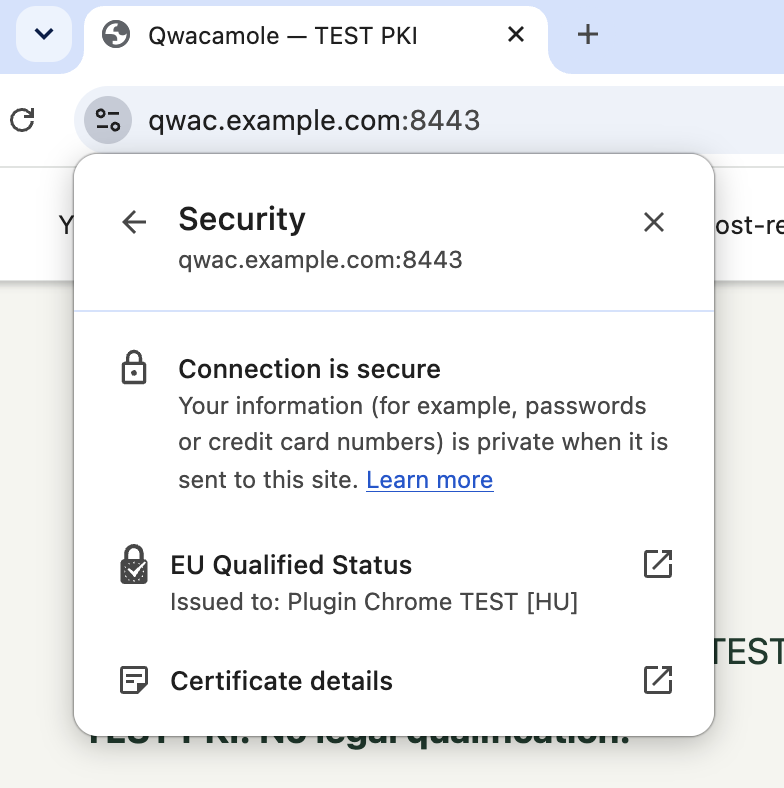
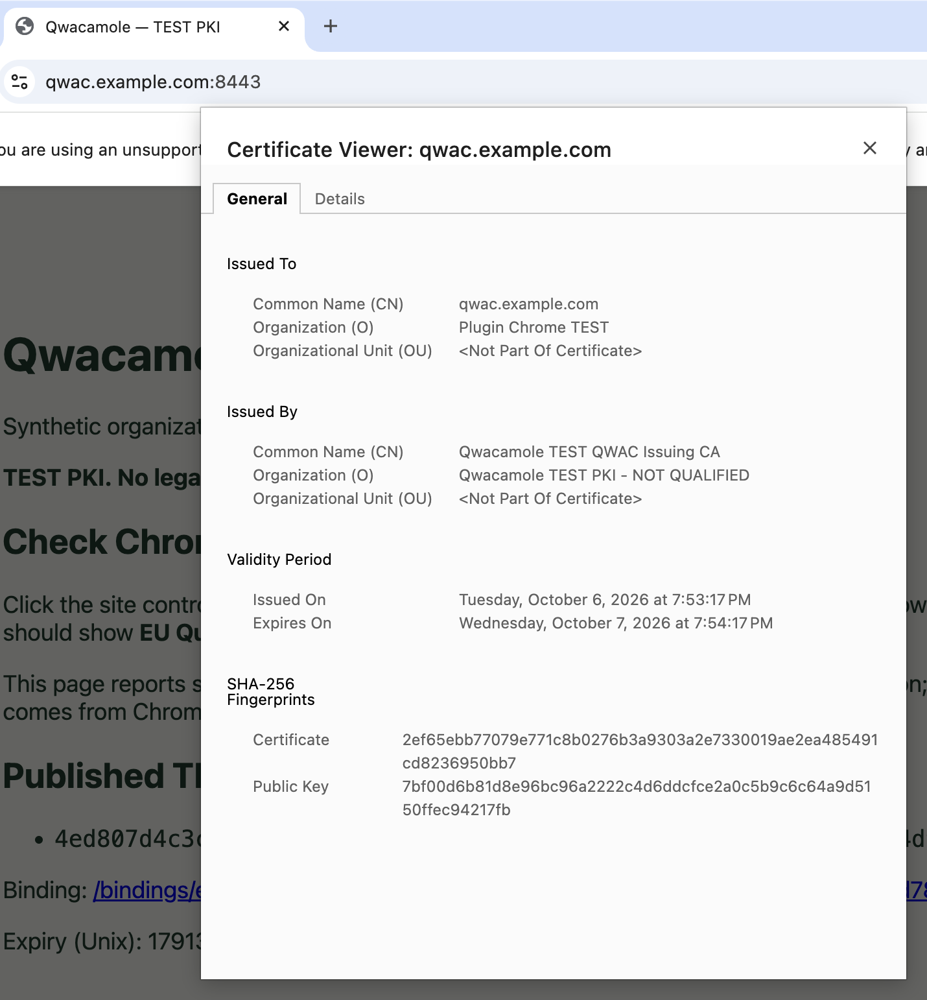
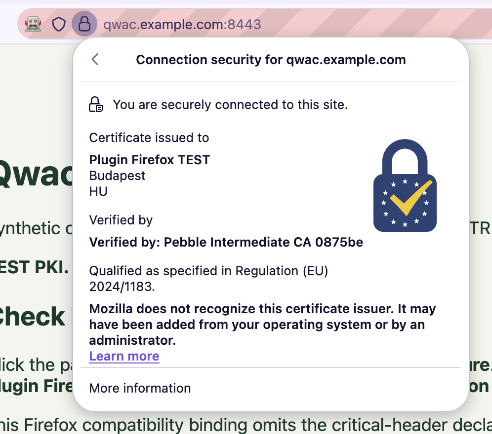

# Installable Caddy plugin evidence — 6 October 2026

This is new execution evidence for `codex/installable-caddy-plugin`, based on
`bd1238f524653219da997a765a786da62a50c61b`. Historical browser evidence remains
in [the monorepo report](evidence-monorepo-20261005.md). The private feature
branch has not been merged and no tags/releases or visibility/license changes
were made. Configuration and operational instructions are in
[the plugin guide](guides/caddy-plugin.md); the README retains both manual demos.

## Immutable remote installation

Core commit: `ced6241dd061c851af7972b20932680be66596fe`, resolved by Go as
`v0.0.0-20261006174406-ced6241dd061`. Implemented plugin commit:
`2cf938efc50b1d714da67e29b6e9adccdf940f25`, resolved as
`v0.0.0-20261006175344-2cf938efc50b`.

The exact successful xcaddy build used the immutable short commit:

```sh
export GOPRIVATE=github.com/cztamas/qwacamole
export GOWORK=off GOEXPERIMENT=nojsonv2
# A fresh GOPATH/GOMODCACHE in an outside-checkout scratch directory,
# with normal authorized private Git authentication:
xcaddy build v2.10.2 \
  --with github.com/cztamas/qwacamole/caddy@2cf938e \
  --output /var/folders/ls/brlwm_w129xbvtcmn03gyrl80000gn/T/qwacamole-remote.J7LXJl/caddy
```

The full hash above selects the same immutable ref. Go 1.27.1, xcaddy 0.4.5,
Caddy 2.10.2 and `GOEXPERIMENT=nojsonv2` were used. The command exited **0**.
No local replacement, workspace or devtools module participated. Build metadata
contains the two resolved versions above, with no `=>` replacement. Inventory
contains `tls.issuance.qwac` and `http.handlers.qwac`, and excludes all development
modules and the devtools dependency. Evidence is under
`.local/evidence/remote-install/` (`build.log`, `plugin-resolved.json`,
`build-modules.txt`, `modules.txt`, `resolved-versions.txt`, `scratch-path.txt`).
The repeatable wrapper is `scripts/check-remote-install.sh <immutable-ref>`;
it copies the installed binary to `bin/caddy-remote`.

Private installation needs repository authorization and scoped GOPRIVATE plus
normal Git credentials. This does not establish anonymous/public distribution.
The core version was obtained from the pushed real commit, not invented.
No dependency pins were upgraded.

## Portable and operational checks

`make build`, `make plugin-build` and `make test` exited **0**. Race tests cover
all three modules; the dependency-boundary check passed. Logs:
`.local/plugin-20261006/{dev-build.log,plugin-build-final.log,tests-final.log}`.
The plugin-only portable smoke exited **0**, with state
`.local/plugin-20261006/plugin-smoke-1611188332/` and log
`.local/plugin-20261006/plugin-smoke-final.log`.

Its actual Caddy binary adapted and validated all three complete examples:
[reverse proxy](../config/Caddyfile.reverse-proxy),
[file server](../config/Caddyfile.file-server), and
[Pebble](../config/Caddyfile.pebble). It rejected invalid/duplicate syntax,
missing trust/settings, bad host/duration, inconsistent issuer/handler settings,
fallback issuers, on-demand TLS and external certificate managers. Legacy numeric
JSON duration was tested; readable strings are now supported. Existing JSON
needs explicit `trust_files`; [the JSON example](../config/plugin.json.example)
and guide show that migration. An advanced explicit issuer plus middleware
Caddyfile also adapted and validated with the remotely built binary; logs are
`.local/plugin-20261006/advanced-validation.log` and adjacent files.

The smoke served a real proxy application, preserved downstream Link,
Cache-Control, status/body and streaming, tested GET/HEAD/405/404 binding paths,
and reloaded to a real file-server application. Pebble performed actual challenge
validation, issuance and automatic renewal; old and new TLS leaves remained in
independently verified durable binding coverage. It exercised three unchanged
forced reloads, same-path QWAC leaf/key replacement under the same authority,
invalid-credential and inconsistent-config reload rejection with the prior app
still live, cross-process state lock conflict, and actual restart/history
recovery. `evidence/result.json` and per-check logs retain the outcomes.

Unit/race coverage also checks PEM bundles and unencrypted RSA PKCS#1/PKCS#8,
key/chain/profile/validity/hostname/trust rejection before ACME, overlapping leases,
rejected candidate staging, cleanup and in-flight operation ownership,
transactional replacement failures, historical document verification, independent
refresh, atomic publication/recovery and retained expired TLS leaves.

Linux hosted CI passed at the exact implemented plugin commit:
[run 37507087991](https://github.com/cztamas/qwacamole/actions/runs/37507087991).
It ran all-module race tests/boundaries and the actual plugin/Pebble/application/
reload smoke, without macOS browser bootstrap. The downloaded artifact is under
`.local/plugin-20261006/ci-artifact/plugin-smoke-3333660281/`.

The exact remotely installed `bin/caddy-remote` then ran the same full smoke
successfully, exit **0**, in
`.local/plugin-20261006/remote-runtime/plugin-smoke-3008638466/`.
The log `.local/plugin-20261006/remote-plugin-smoke.log` and result JSON confirm
all thirteen operational checks above, including actual application behavior,
ACME renewal, reload/replacement/rejection and restart. This validates the
implemented remote artifact as well as the locally built plugin.

## Fresh Chrome execution

Chrome **154.0.8037.98**, genuine PKIMetadata **1798**, isolated injected QWAC
root-store version **1000000**. Fresh state:
`.local/plugin-20261006/browsers/browser-demo-1715335384/` (called `$C` below).
Owner: **Plugin Chrome TEST [HU]**. Ordinary Pebble TLS trust and QWAC authority
trust remain separate. Only the development process receives the explicit CT
exception; ordinary certificate validation remains enabled.

```sh
bin/qwacamole browser-demo -state .local/plugin-20261006/browsers \
  -organization 'Plugin Chrome TEST'
bin/qwacamole browser -state "$C" -ct-exception \
  -tls-root "$C/pki/pebble-root.pem" -profile "$C/profiles/lifecycle" -name initial
bin/qwacamole lifecycle -state "$C"
bin/qwacamole browser -state "$C" -ct-exception \
  -tls-root "$C/pki/pebble-root.pem" -profile "$C/profiles/lifecycle" -reuse-profile -name renewed
bin/qwacamole refresh-test -state "$C"
bin/qwacamole fixture -state "$C" # keep running in a separate terminal for suite
bin/qwacamole browser-suite -state "$C"
bin/qwacamole failure-test -state "$C"
bin/qwacamole browser -state "$C" -ct-exception \
  -tls-root "$C/pki/pebble-root.pem" -profile "$C/profiles/lifecycle" -reuse-profile -name failure-recovery
# Complete failure/restart operations before the continuous connection check:
bin/qwacamole browser -state "$C" -ct-exception \
  -tls-root "$C/pki/pebble-root.pem" -name through-expiry-final -through-tls-expiry
# Only after the expiry check finishes:
touch "$C/restart-request"
bin/qwacamole browser -state "$C" -ct-exception \
  -tls-root "$C/pki/pebble-root.pem" -profile "$C/profiles/lifecycle" -reuse-profile -name restarted
```

Native initial and renewed binding verification succeeded with unchanged profile
and trust. The observed TLS fingerprints changed from
`4ed807d4c3c47be68d11d13a3ff15f08724e6a12b2c230149353b953105e4d9a`
to `724b8eb3693a4ae9eb02c00efca7e1ebcf054ca137b4fdb95e569011a6566473`.
Both results use root version 1000000, end at the exact injected QWAC authority,
and report native `is_valid_2qwac_binding: true`. `rotation.json` proves real
automatic renewal and old/new coverage; `refresh-test.json` proves a different
binding URL after 54 seconds with identical TLS IDs.

Signing and durable-publication failure injection each refused the replacement
TLS certificate while old HTTPS/binding remained valid. Automatic retry recovered
with TLS ID `1758cd69a723cdab5d1e25e18560a96d7b1b16f0dbb402cf5978f201d2c838ab`;
its reused-profile native check passed. See `failure-test.json`,
`failure-recovery-result.json` and raw NetLogs under `$C/evidence/`.

The native suite had **10 passes and exactly one failure**, preserving **exit 1**:
`expired-binding: BROWSER INCOMPATIBILITY: native verifier accepted expired exp header`.
This is the previously accepted Chromium ignored-exp gap. No additional exception
was accepted. Results are `browser-suite.json`, per-case NetLogs, and
`.local/plugin-20261006/chrome-suite-outcome.json`.

The final HTTP/2 run exited **0**. Raw NetLog identifies held session **467**,
TLS socket **453**, serving **18** main navigations continuously from
`2026-10-06T18:06:46.363Z` through `18:13:00.011Z`. Its TLS leaf
`5ca29bc90098b1c0e2426a142d7e549d4d3c0e9002f09fae85c01c41c84ff270`
expired at `18:12:15Z`; the final certificate check was at `18:13:02.030Z`,
more than one binding lifetime afterward. The socket's received certificate
matches that fingerprint. No main navigation changed sessions and the session
closed only when the browser exited. Native binding verification succeeded both
before and after expiry. `http2-session-proof.json`,
`through-expiry-final-result.json` and its raw NetLog record the proof.

Chrome closed startup session 288 during component setup; it is explicitly
excluded from the continuous interval above. An earlier run also had a startup
transition and was not used as uninterrupted-session proof. Certificate equality
alone was insufficient; the accepted interval is grounded in the HTTP/2 source
and TLS socket events. No Caddy restart/reload/failure injection occurred during
that interval.

After the final expiry run, the supervisor restarted only Caddy (PID 51734 →
54636), keeping Pebble PID 51699 and browser trust unchanged. The reused lifecycle
profile's `restarted-result.json` native check exited **0**. The visible demo
supervisor then shut down its owned children and exited **0**, asserting native
acceptance. Its log is `.local/plugin-20261006/chrome-demo.log`.

The user confirmed the native qualified status and expected owner. Supplied
unmodified screenshots show both the native panel and QWAC certificate viewer;
QWAC SHA-256 is
`2ef65ebb77079e771c8b0276b3a9303a2e7330019ae2ea485491cd8236950bb7`.




## Fresh Firefox execution

Firefox **157.0**, geckodriver **0.37.1**, fresh state
`.local/plugin-20261006/browsers/browser-demo-69137474/` (called `$F` below),
owner **Plugin Firefox TEST [HU]**. Chrome services and the remote smoke stopped
before this Firefox launch. Native UI reports `secure-etsi`, qualified text
“Qualified as specified in Regulation (EU) 2024/1183.”, matching owner/country,
`qualified_visible: true`, `certificate_overridden: false` and
`accept_insecure_certs: false`. Initial visible evidence is
`$F/evidence/firefox-result.json`; page screenshots alone were not used as proof.

```sh
bin/qwacamole firefox-demo -state .local/plugin-20261006/browsers \
  -organization 'Plugin Firefox TEST'
bin/qwacamole firefox-check -state "$F" -profile "$F/profiles/renewal" -name before-renewal
# After current.json records real automatic renewal, without re-preparing trust:
bin/qwacamole firefox-check -state "$F" -profile "$F/profiles/renewal" -reuse-profile -name after-renewal
bin/qwacamole fixture -state "$F" # separate terminal, keep running for suite
bin/qwacamole firefox-suite -state "$F"
```

Before/after renewal commands exited **0**, reusing the exact profile without
trust preparation. TLS ID changed from `8cffe218c1803fc7b638f1532a2c0852c31659316f95828bab78c2179b089cd6`
to `3fc707d8ff529030ac5a87a4afe7d3168e6d0f660dc57ce9425ec254b8815984`. QWAC fingerprint stayed
`5bf5e6828a7842c27e8b7ee2d16442c44c95352ec1b64873adfd9669bccd958b`;
owner/country, native qualified text/visibility and `secure-etsi` connection stayed
the same. Both TLS IDs remain bound in the current manifest.
`$F/evidence/firefox-renewal.json`, `firefox-before-renewal/firefox-result.json`
and `firefox-after-renewal/firefox-result.json` retain these assertions. The script
log is `.local/plugin-20261006/firefox-renewal-proof.log`.

The native Firefox suite exited **0**, **11/11 passed**: positive, no QWAC
trust, no TLS trust, corrupted signature, wrong TLS hash, QWAC hostname,
expired binding, QWAC profile, TLS hostname, TLS expiry and critical header.
Expiry rejection was `header has expired`; standard-crit rejection was
`header contains invalid parameter`. Results are `$F/evidence/firefox-suite.json`
and each `firefox-suite-*/firefox-result.json`, with native failure reasons and
unmodified normal certificate validation. No Chromium exception was applied.
The console log is `.local/plugin-20261006/firefox-suite.log`.

The user also confirmed the visible native owner and qualified text and supplied
the unmodified screenshot below. The visible
demo supervisor then stopped its owned services and exited **0**; its log is
`.local/plugin-20261006/firefox-demo.log`.



TLS trust is the fresh Pebble root imported only into this profile's NSS.
QWAC recognition uses Firefox's separate compiled Mozilla public TEST authority
list, enabled only by explicit profile preference, and the attributed publicly
forgeable devtools fixture. The fixture root expires 5 February 2027. The
compatibility profile explicitly omits the standard `crit` declaration; it is
never selected by User-Agent. The stock identity-panel preference avoids the
known Trust Panel UI error without changing verification. No system/ordinary
profile trust or Firefox binary was modified, and no TLS/CT bypass was applied.

Compact copies of the final native/operational assertions are committed under
[`docs/evidence/plugin-20261006/`](evidence/plugin-20261006/): Chrome HTTP/2 proof
and exact suite outcome, Firefox native UI/renewal/all-eleven outcomes, and remote
plugin smoke. Full raw NetLogs, manifests and service logs remain in the local
state paths above. These compact records contain no private key material.

## Completion audit

| Objective | Evidence |
|---|---|
| Real immutable core and implemented remote plugin | Canonical versions/build metadata, fresh outside-checkout cache, no replacements/devtools, successful inventory and installed-binary smoke. |
| Normal Caddyfile and JSON | All three actual examples adapt/validate; explicit advanced form, readable/legacy durations, invalid syntax/pairing/bypass controls and migration documented. |
| Early supplied credentials | RSA bundle/PKCS#1/PKCS#8 tests, explicit authority, key/chain/profile/validity/hostname rejection before issuance; no provisioning trust/enrollment. |
| Overlap/reload/cleanup | Lease/race/transactional failure tests plus actual unchanged reloads, same-path replacement, rejected reloads, process ownership and restart smoke. |
| HTTP middleware | Actual application/header/body/status/streaming checks; constrained GET/HEAD binding documents, 405/404, current advertisement and unrelated-host/fail-closed tests. |
| Existing lifecycle | Pre-return signed/verified/durable gate retained; atomic/history/recovery tests, independent refresh/failure retry, native renewal/restart and authenticated HTTP/2 past expiry. |
| Portable checks | All-module races/boundaries, exact implemented-ref Linux CI and local/remote plugin-only real ACME/application runs. |
| Both native browsers | Fresh sequential runs, unchanged renewal trust, Chrome native owner/status and only accepted expired-exp exit 1; Firefox native owner/status and all eleven controls exit 0. |
| Documentation/delivery | README manual quickstarts preserved; private install, examples/migrations, operations/troubleshooting, new evidence, growth limits and public-license/release decisions recorded. |

## Supported limits and release steps

This is supplied-RSA, explicit-local-authority, single-host ACME scope, with strict
standard binding by default and explicit Firefox compatibility. Provisioning does
not generate authorities/QWACs, alter browser trust or fetch roots. Separate
browser authority recognition and legal/QTSP qualification are not established by
local checks. Authority migration, watching, HSM/encrypted/non-RSA keys,
distributed state and garbage collection remain outside scope. All published TLS
coverage/documents are retained; size grows with renewals. New TLS handshakes
still enforce expiry even though existing authenticated connections keep coverage.

Private installation is supported. Public distribution still requires the owner's
visibility/license decision. Future root `vX.Y.Z` and nested `caddy/vX.Y.Z` tags
require sequential core release, dependency update and exact-ref remote validation.
No merge, tag/release or license decision was made by this work.
